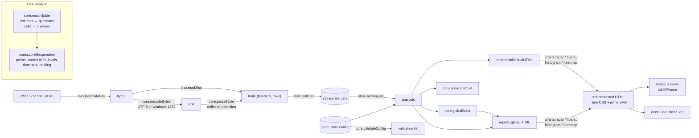
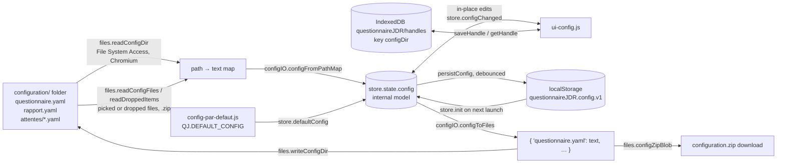

# Developer guide – Questionnaire JDR

This document describes the code as it is in `QuestionnaireJDR/app/js/` and
`dev/`. Read [`README.md`](../README.md) first for the folder map and the
commands.

Contents

1. [Architecture overview](#1-architecture-overview)
2. [Script load order and the `QJ` namespace](#2-script-load-order-and-the-qj-namespace)
3. [Core module API (pure, Node-testable)](#3-core-module-api-pure-node-testable)
4. [Configuration schema reference](#4-configuration-schema-reference)
5. [Scoring and level rules](#5-scoring-and-level-rules)
6. [Text normalisation and matching rules](#6-text-normalisation-and-matching-rules)
7. [CSV, ZIP and XLSX robustness rules](#7-csv-zip-and-xlsx-robustness-rules)
8. [Report rendering](#8-report-rendering)
9. [YAML serializer and why it exists](#9-yaml-serializer-and-why-it-exists)
10. [Browser storage, persistence and the "active configuration" states](#10-browser-storage-persistence-and-the-active-configuration-states)
11. [Testing strategy and how to add tests](#11-testing-strategy-and-how-to-add-tests)
12. [How to add a feature](#12-how-to-add-a-feature)
13. [Known limitations](#13-known-limitations)
14. [Conventions](#14-conventions)
15. [Web version: PWA, service worker, tablets, GitHub Pages](#15-web-version-pwa-service-worker-tablets-github-pages)

---

## 1. Architecture overview

The application is a set of classic scripts sharing one global object `QJ`.
It is split in two layers:

- **Pure modules** (no DOM, no browser API): `core.js`, `charts.js`,
  `reports.js`, `config-io.js`, `xlsx.js`. Each is wrapped in a small UMD
  header: in the browser it registers itself on `QJ`, under Node it is
  `module.exports`. The unit tests `require()` these files directly from
  `QuestionnaireJDR/app/js/`.
- **Browser modules**: `util.js` (DOM helpers, device detection, share,
  print), `pwa.js` (service-worker registration, update toast), `store.js` (state +
  persistence + event bus), `files.js` (file reading, File System Access,
  IndexedDB, ZIP), the five `ui-*.js` tab modules and `main.js` (start-up).

### Data flow: from the responses file to the reports



### Configuration flow: YAML files, GUI and persistence



### Runtime pieces in one sentence each

| File | Role |
|---|---|
| `main.js` | `start()`: `store.init()`, `init()` of every tab module, tab buttons, the configuration banner (`renderBanner`), global drag-and-drop fallback. Exposes `QJ.main.showTab/activeTab/describeMeta/renderBanner`. |
| `store.js` | Holds `state = { config, meta, data, analysis, validation }`; recomputes validation + analysis (debounced for text edits, immediate for structural edits); persists to localStorage; events `config`, `meta`, `data`, `analysis`. |
| `files.js` | Response files (`loadDataFile`, ZIP/XLSX/CSV dispatch), File System Access (`pickDirectory`, `readConfigDir`, `writeConfigDir`, `verifyPermission`), IndexedDB handle memory (`saveHandle/getHandle/forgetHandle`), fallbacks (`readConfigFiles`, `readDroppedItems`, `configZipBlob`). |
| `ui-donnees.js` | Drop zone / file picker / "Charger l'exemple"; summary KPIs; sorted warnings with "Ajouter à la configuration…" actions. |
| `ui-individuels.js` | Respondent list with search, iframe preview, export one `.html`, export all as `Rapports individuels.zip`, print. |
| `ui-global.js` | Global report iframe, export `.html`, export `Scores des répondants.csv`, print. |
| `ui-config.js` | Five sub-sections (Général, Attentes, Textes des rapports, Questions et poids, Ouvrir / Enregistrer); live validation badges; proposals from a file; load/save flows. |
| `ui-aide.js` | Probes `documentation/guide.html` with a `<link media="not all">` trick (no `fetch` over `file://`) and shows it in an iframe. |
| `util.js` | `h()` element builder, `modal`, `confirm`, `toast`, `downloadBlob/Text`, `debounce`, `readFileBuffer/Text`, `msg`, `fillFrame` (srcdoc + auto-height). |

---

## 2. Script load order and the `QJ` namespace

`index.html` (and its generated copy `Questionnaire JDR.html`) loads, in this
order (each script assumes the previous ones are present):

```html
<script src="app/vendor/js-yaml.min.js"></script>   <!-- global jsyaml -->
<script src="app/vendor/jszip.min.js"></script>     <!-- global JSZip -->
<script src="app/js/core.js"></script>              <!-- QJ.core -->
<script src="app/js/charts.js"></script>            <!-- QJ.charts -->
<script src="app/js/reports.js"></script>           <!-- QJ.reports     (needs core, charts) -->
<script src="app/js/config-io.js"></script>         <!-- QJ.configIO    (needs jsyaml) -->
<script src="app/js/xlsx.js"></script>              <!-- QJ.xlsx        (needs JSZip at call time) -->
<script src="app/js/config-par-defaut.js"></script> <!-- QJ.DEFAULT_CONFIG (generated) -->
<script src="app/js/exemple-donnees.js"></script>   <!-- QJ.EXAMPLE_CSV    (generated) -->
<script src="app/js/util.js"></script>              <!-- QJ.util        (needs core for readFileText) -->
<script src="app/js/pwa.js"></script>               <!-- QJ.pwa         (needs util; registers sw.js over http(s) only) -->
<script src="app/js/store.js"></script>             <!-- QJ.store       (needs core, util, DEFAULT_CONFIG) -->
<script src="app/js/files.js"></script>             <!-- QJ.files       (needs core, util, configIO, xlsx, JSZip) -->
<script src="app/js/ui-donnees.js"></script>        <!-- QJ.uiDonnees -->
<script src="app/js/ui-individuels.js"></script>    <!-- QJ.uiIndividuels -->
<script src="app/js/ui-global.js"></script>         <!-- QJ.uiGlobal -->
<script src="app/js/ui-config.js"></script>         <!-- QJ.uiConfig -->
<script src="app/js/ui-aide.js"></script>           <!-- QJ.uiAide -->
<script src="app/js/main.js"></script>              <!-- QJ.main, calls start() -->
```

Every file is an IIFE `(function (QJ) { … })(window.QJ = window.QJ || {})` or
the UMD variant for the pure modules. There is no module loader, no `import`,
no transpilation; the code is written in ES5 syntax (`var`, `function`,
`Array.prototype.forEach.call`) so that it also runs in older engines, while
the dev tools under `dev/tools/` use modern ESM.

Under Node, the pure modules resolve their own dependencies:
`reports.js` does `require('./core.js')` and `require('./charts.js')`,
`config-io.js` does `require('../vendor/js-yaml.min.js')`, and
`xlsx.readXlsx(bytes, JSZip)` takes the JSZip constructor as a second argument.

---

## 3. Core module API (pure, Node-testable)

All functions below are exported by `core.js` (`QJ.core` / `require(...)`).
"config" always means the internal model described in section 4.

### Utilities

| Function | Description |
|---|---|
| `deepClone(obj)` | JSON round-trip clone. |
| `isNum(x)` | finite number test. |
| `formatNumber(x, decimals)` | French formatting: decimal comma, trailing zeros trimmed, `'—'` for non-numbers. |
| `fillPlaceholders(text, vars)` | Replaces `{key}` (`[a-z_]+`) with `vars[key]`; unknown keys are left untouched. |
| `safeFileName(name)`, `uniqueFileNames(respondents, prefix, ext)` | Windows-safe file names (accents kept, `\/:*?"<>|` removed, reserved names prefixed, 80 chars max) and ` (2)`, ` (3)` suffixes on case-insensitive collisions. |
| `slugify(text)` | Builds an attente id: lowercase, accents stripped, `œ→oe`, non `[a-z0-9]` → `_`. |
| `nextQuestionId(config)` | First unused `q01`, `q02`, … |

### Text normalisation and matching (details in section 6)

`normalize(text)`, `looseKey(text)`, `makeMatcher(texts) → (text) => index | -1`.

### CSV and timestamps (details in section 7)

`decodeBytes(bytes) → { text, encoding }`, `detectDelimiter(text)`,
`parseCSV(text, delimiter?) → rows[][]`, `parseTable(text) → { headers, rows, delimiter }`,
`parseTimestamp(raw) → { raw, y, mo, d, h, mi, s, key, label, dateLabel } | { raw, key, label } | null`.

### Matching, scoring and analysis (details in section 5)

| Function | Returns |
|---|---|
| `maxPoints(config)` | `{ attenteId: number }` – maximum points reachable per attente. |
| `levelFor(attente, score)` | `{ index, number, total, niveau }` or `null`. |
| `matchTable(config, table)` | `{ respondents, columns, warnings, unmatchedColumns, missingQuestions, unmatchedValues }` (see below). |
| `scoreRespondent(config, answers, maxCache?)` | `{ scores, points, max, levels, dominant, ranking }`. |
| `analyze(config, table)` | `matchTable` result with every respondent enriched by `scoreRespondent` and `analysis.max`. |
| `globalStats(config, analysis)` | aggregate statistics (section 5). |
| `validateConfig(config)` | list of `{ level: 'erreur'|'attention', section: 'general'|'attentes'|'questions'|'rapport', message, ref }`. |
| `proposeFromTable(config, table)` | `{ newQuestions: [{ texte, reponses: [{ texte, count }] }], newAnswers: [{ qid, qIndex, texte, count }] }`. |
| `scoresToCSV(config, analysis)` | Excel-FR CSV text (`;`, decimal comma, UTF-8 BOM, CRLF). |

Shape of a **respondent** inside an analysis:

```js
{
  index: 1,                       // 1-based row number, used for anchors #r-<index>
  name: 'Répondant 1',            // or the identifier column value
  timestamp: { … } | null,        // parseTimestamp result
  answers: { q01: 2, q02: null }, // answer index per question id, null = unanswered/unknown
  unanswered: 1,                  // questions counting 0 points (empty OR unknown)
  unknown: 0,                     // subset of the above whose text was not recognised
  // added by analyze():
  scores: { competition: 62.5, … } | null per attente,
  points: { … }, levels: { competition: { index, number, total, niveau } | null },
  dominant: ['competition'],      // [] when undetermined, 2+ ids when tied
  ranking: ['competition', 'strategie', …]
}
```

`warnings` entries are `{ level: 'erreur'|'attention'|'info', message, details?, kind? }`
where `kind` is `'colonne'` (unknown column), `'question'` (missing question)
or `'reponse'` (unknown answer value); the Données tab offers "Ajouter à la
configuration…" for `colonne` and `reponse`.

### Statistics

`mean`, `median`, `stdDev` (sample, n−1, `0` for a single value), `correlation`
(Pearson, pairs with a missing value skipped, `null` if < 2 pairs or zero
variance), `histogram(values, binWidth = 10)` → 10 bins `[0,10) … [90,100]`.
All ignore non-numeric values.

### Other pure modules

- `charts.js`: `esc(s)` (HTML escape), `fmt(x, d)` (French number),
  `radar(opts)`, `hbars(opts)`, `scoreBar(value, color, opts)`,
  `histogram(bins, color, opts)`, `heatmap(matrix, labels, opts)`,
  `divergingColor(v)`. All return SVG strings.
- `reports.js`: `CSS` (string), `individualFragment(config, r, { id? })`
  (an `<article>`), `individualHTML(config, r)` (full document),
  `globalHTML(config, analysis, { fileName?, warnings? })`, `paragraphs(text, vars)`.
- `config-io.js`: `configFromYamlTexts({ questionnaire, rapport, attentes: { id: text } })`,
  `configFromPathMap({ 'path/file.yaml': text })` → `{ config | null, problems }`,
  `configToFiles(config)` → `{ 'questionnaire.yaml': text, 'rapport.yaml': text, 'attentes/<id>.yaml': text }`,
  `serializeQuestionnaire`, `serializeRapport`, `serializeAttente`, `emitText`.
- `xlsx.js`: `readXlsx(bytes, JSZip?) → Promise<{ headers, rows }>`, `serialToDate(n)`.

---

## 4. Configuration schema reference

### Internal model (what the app manipulates)

```js
{
  titre: string,
  colonne_identifiant: string,          // '' = none
  colonne_horodatage: string,           // default 'Horodateur'
  attentes: [ { id, nom, couleur, titre, description,
                niveaux: [ { a_partir_de: number, titre, texte } ] } ],
  questions: [ { id, texte, reponses: [ { texte, poids: { attenteId: number } } ] } ],
  rapport:   { titre_rapport_individuel, introduction, titre_profil_dominant,
               texte_profil_mixte, conclusion, pied_de_page,
               titre_rapport_global, introduction_rapport_global, ...extra string keys }
}
```

The list of the eight `rapport` keys is `RAPPORT_FIELDS`, defined once in
`core.js` (`core.RAPPORT_FIELDS`); `config-io.js` reads it from there.
Extra string keys found in `rapport.yaml` are preserved on load and save, and
so are weights whose key is not a known attente (validation flags them as
errors but nothing is silently dropped).

### `configuration/questionnaire.yaml`

| Key | Type | Meaning | On load (`configFromYamlTexts`) |
|---|---|---|---|
| `titre` | string | Questionnaire title; kicker of every report, `{questionnaire}` placeholder, app subtitle. | `''` if absent. |
| `colonne_identifiant` | string | Header of the CSV column holding the player's name/pseudo. Empty → "Répondant N". | `''` if absent. |
| `colonne_horodatage` | string | Header of the timestamp column added by Google Forms. | **`'Horodateur'` if the key is absent**; `''` if explicitly empty. |
| `attentes` | list of ids | Display order of the attentes. Each id must have a file `attentes/<id>.yaml`. | Missing file → error + stub attente (grey, one level). Files not listed → info, ignored. |
| `questions[]` | list | | |
| `questions[].id` | string | Stable identifier (`q01`…). Used in test ids and warnings. | Defaults to `q<n>` (1-based) if absent. |
| `questions[].texte` | string | Must match the Google Form column header (after normalisation, section 6). | |
| `questions[].reponses[].texte` | string | Must match the cell value in the CSV. | |
| `questions[].reponses[].poids` | map `{ attenteId: number }` | Points the answer gives to each attente. Absent key = 0. Non-numeric values are kept as-is so validation can report them. | Serialised as a flow map `{ strategie: 2, competition: 1 }`, zeros omitted. |

Validation (`core.validateConfig`) — errors (`erreur`) block nothing at runtime
but are counted in the banner and trigger a confirmation before saving:

- attentes: empty list; id not matching `/^[a-z0-9_-]+$/`; duplicate id; no
  level; first level not at 0; threshold not a number or outside 0–100;
  thresholds not strictly increasing; attente with `maxPoints == 0` (score
  cannot be computed).
- questions: empty list; empty text; duplicate normalised text; missing or
  duplicate id; empty or duplicate answer text; weight for an unknown attente;
  non-numeric or negative weight.

Warnings (`attention`): empty attente name, invalid colour (expects `#RRGGBB`),
level without title, question with < 2 answers, answer whose weights are all 0,
empty report text, `colonne_horodatage` undefined.

### `configuration/rapport.yaml`

All values are free text. Long texts are written as folded blocks (`>-`); a
blank line in the text is a paragraph break in the report, a single newline
becomes `<br>`.

| Key | Used in |
|---|---|
| `titre_rapport_individuel` | `<h1>` of the individual report and `<title>` of the exported file (`"<titre> – <nom>"`). Default `'Votre profil de joueur'` if empty. |
| `introduction` | Paragraphs under the individual header. |
| `titre_profil_dominant` | Heading of the dominant-attente box next to the radar. Default `'Votre attente principale'`. |
| `texte_profil_mixte` | Body of that box when 2+ attentes tie. |
| `conclusion` | Dashed box at the end of the individual report. |
| `pied_de_page` | Footer line of the individual report (inline, no paragraphs). |
| `titre_rapport_global` | `<h1>` and `<title>` of the global report. Default `'Synthèse des réponses'`. |
| `introduction_rapport_global` | Paragraphs under the global header. |

**Placeholders** (`core.fillPlaceholders`, applied to every `rapport.*` text and
to the level texts, not to attente names/titles/descriptions):

| Placeholder | Value |
|---|---|
| `{joueur}` | respondent name (`''` in the global report) |
| `{nombre_attentes}` | number of attentes |
| `{questionnaire}` | `titre` of the questionnaire |

Unknown `{mots}` are left as written.

### `configuration/attentes/<id>.yaml`

| Key | Type | Meaning |
|---|---|---|
| `id` | string | Informational: **the file name wins**. A mismatch produces a warning. |
| `nom` | string | Short label: radar axes, chips, table headers, CSV export columns. Defaults to the id. |
| `couleur` | `#RRGGBB` | Colour of the attente everywhere (radar dots, bars, borders). Defaults to `#888888`. |
| `titre` | string | Heading of the attente section in the individual report (e.g. "Quel stratège êtes-vous ?"). Falls back to `nom`. |
| `description` | string | One or two sentences, shown in the dominant box. Trailing whitespace trimmed. |
| `niveaux[]` | list, ascending | Levels. `a_partir_de` = minimum score in % (inclusive) to reach the level, first must be `0`; `titre` = level title; `texte` = level text (placeholders allowed, paragraphs allowed). Any number of levels ≥ 1. |

### Where the shipped default comes from

`QuestionnaireJDR/configuration/` is the source of truth;
`dev/tools/build_default_config.mjs` loads it with the app's own
`config-io.js` and writes `app/js/config-par-defaut.js` (`QJ.DEFAULT_CONFIG`,
a JSON literal of the internal model). The shipped configuration has 6 attentes
and 32 questions; the e2e test relies on those (`cfg-attente-competition`,
`poids-q01-<i>-hasard`, and a newly added question being `q33`).

---

## 5. Scoring and level rules

Implemented in `core.js` (`maxPoints`, `scoreRespondent`, `levelFor`,
`dominantOf`, `rankingOf`, `globalStats`).

1. **Points.** For each question the respondent answered with a recognised
   answer, each attente receives `poids[attenteId]` of that answer (0 if
   absent). A question left empty, missing from the file, or whose value is not
   recognised gives 0 points to everything and is counted in
   `respondent.unanswered` (plus `unknown` for the unrecognised case).
2. **Maximum.** `maxPoints(config)[a]` = Σ over questions of the *best* weight
   any answer of that question gives to `a`. It depends only on the
   configuration, not on the respondent, so a respondent can never exceed 100 %.
3. **Score.** `score[a] = 100 × points[a] / max[a]`, or `null` when
   `max[a] == 0` (shown as "—" / "Score non calculable" and flagged by
   validation).
4. **Level.** `levelFor(attente, score)` picks the **last** level whose
   `a_partir_de ≤ score + 1e-9` (thresholds are inclusive; 25 reaches a level
   "à partir de 25"). Returns `{ index, number (1-based), total, niveau }`, or
   `null` when the score is `null` or there are no levels. Levels are meant to
   be ascending; validation enforces it, `levelFor` itself just scans.
5. **Dominant attente.** All attentes whose score equals the best score (within
   1e-9). If the best score is `≤ 0` or no score is numeric, `dominant = []`
   ("Pas assez de réponses pour déterminer une attente principale"). Two or more
   ids = "Profil mixte".
6. **Ranking.** Attentes sorted by score descending; `null` scores sort last
   (treated as −1); ties keep configuration order. The individual report lists
   the attente sections in this order.

`globalStats(config, analysis)` returns:

| Field | Content |
|---|---|
| `count` | number of respondents |
| `first`, `last` | earliest/latest parsed timestamp (only those with a year) |
| `perAttente[id]` | `mean, median, std, min, max` of the scores; `histogram` (10 bins); `levels` (count per level index); `dominantCount` (sole dominant); `sharedDominantCount` (dominant in a tie) |
| `correlation` | n×n Pearson matrix in attente order; diagonal is `1` when ≥ 2 numeric scores and non-zero variance, else `null` |
| `mixed` | `{ 'a+b': count }` of tie combinations; `mixedCount`; `undetermined` |
| `questions[]` | per question `{ id, counts: [per answer index], none }` |

Global report flags on answers: "jamais choisie" when `count == 0`;
"très majoritaire" when ≥ 80 % and at least 5 respondents.

---

## 6. Text normalisation and matching rules

Google Forms exports and hand-typed YAML differ in apostrophes, quotes, case,
spacing and trailing punctuation. Matching never compares raw strings.

`normalize(text)` (`core.js`):

1. Unicode NFKC, lowercase.
2. `‘ ’ ‚ ‛ ` ´ ′` → `'`; `“ ” „ ‟ « » ″` → `"`; `…` → `...`;
   all hyphen/dash variants (`‐ ‑ ‒ – — −`) → `-`.
3. Any run of whitespace (including NBSP, narrow NBSP, zero-width space) → one
   space; spaces inside quotes (`" texte "` → `"texte"`) and before French
   double punctuation (` !`, ` ?`, ` ;`, ` :`) removed.
4. Leading `. … , ; : ' " « » - – —` and spaces stripped; trailing
   `. , ; : ! ? … ' " » « ( ) - – —` and spaces stripped; trimmed.

So `"... Jouer sur un layout."` ≡ `"…jouer   sur un LAYOUT"` and
`"Question ?"` ≡ `"question"`.

`looseKey(text)` = `normalize` then NFD with combining marks removed, `œ→oe`,
`æ→ae`, and everything except `[a-z0-9]` deleted. It is the fallback key
(accents and all punctuation ignored).

`makeMatcher(texts)` builds two indexes over candidate texts. `match(text)`:

1. exact match on `normalize` → index of the first candidate with that key;
2. else match on `looseKey`, **unless** that loose key is ambiguous (two
   different candidates share it, stored as `-2`);
3. else `-1`.

How `matchTable` uses it:

- Unmatched columns that look like a player name (header in a small FR/EN list such as pseudo/nom/prénom/e-mail/name, or ≥ 5 short values almost all distinct and matching no configured answer; `core.looksLikeIdentifier`) get a warning of `kind: 'identifiant'` (French hint + one-click « Utiliser comme colonne identifiant » in the Données tab) instead of the generic « Ajouter à la configuration… » action; `proposeFromTable` flags them `identifier: true` and the proposals dialog leaves them unchecked.
- The timestamp and identifier columns are matched by **`normalize` equality
  only** (no loose fallback), first occurrence wins.
- Question columns use a matcher over `questions[].texte`. A header matching a
  question already assigned is reported as a duplicate column and ignored
  (first column wins). Non-empty headers matching nothing are "Colonne non
  reconnue (ignorée)" and feed `proposeFromTable`.
- Cell values use one matcher per question over `reponses[].texte`. Unknown
  values are aggregated per question with a count (`unmatchedValues`), and the
  respondent gets `null` for that question.
- Searching in the UI (question filter, respondent search) also uses
  `normalize` substring matching.

---

## 7. CSV, ZIP and XLSX robustness rules

`files.loadDataFile(file)` dispatches on content and extension:

| Input | Handling |
|---|---|
| `.xls`, `.ods`, `.numbers` | rejected with a French message (export CSV instead). |
| bytes starting with `PK` and extension ≠ `.xlsx` | ZIP (what Google Forms downloads): the first entry matching `.csv` or `.xlsx` (ignoring `__MACOSX/`) is extracted and processed recursively. |
| `.xlsx` (or any other ZIP) | `xlsx.readXlsx`: first worksheet (resolved through `workbook.xml` + rels), shared strings, inline strings, booleans (`VRAI`/`FAUX`), and cells whose style is a date format converted from Excel serials to `YYYY/MM/DD HH:MM:SS`. Rows made only of blanks are dropped; rows are padded to the header width. |
| anything else | CSV text. |

CSV text path (`core.js`):

- **Encoding** (`decodeBytes`): a UTF-8 BOM is skipped; the bytes are decoded
  as strict UTF-8 (`TextDecoder('utf-8', { fatal: true })`). If that throws
  *or* the result contains U+FFFD, the bytes are decoded as **windows-1252**
  (typical of a CSV re-saved by Excel on Windows). `encoding` is reported in
  the Données tab (`'UTF-8'`, `'windows-1252'`, `'UTF-8 (avec erreurs)'`).
- **Delimiter** (`detectDelimiter`): on a sample of up to 64 KB cut at a line
  boundary, each of `,` `;` `\t` is tried with the real parser on the first 20
  records; a candidate wins if every record has the same number of fields (≥ 2)
  and it yields the most fields. If none is consistent, the most frequent
  candidate in the header line (outside quotes) wins, defaulting to `,`. This is
  why `Horodateur;Concernant, les décors;…` is detected as `;` despite the commas.
- **Parsing** (`parseCSV`): RFC 4180 — quoted fields, doubled quotes, newlines
  inside quotes, CR/LF/CRLF, a final record without newline. Fully empty lines
  and lines made only of blanks are dropped. `parseTable` takes the first
  record as headers.
- **Timestamps** (`parseTimestamp`): accepts `2026/11/03 21:14:05 UTC+1`,
  `2026-11-03T21:14`, `03/11/2026 21:14`, two-digit years (+2000) and `.`/`-`
  separators. The wall-clock time is kept as written (no timezone math).
  `key` is a sortable `YYYY-MM-DD HH:MM:SS`, `label` is `DD/MM/YYYY HHhMM`,
  `dateLabel` is `DD/MM/YYYY`. Unrecognised strings are kept verbatim as
  `{ raw, key, label }` (no `y`, so they are excluded from the period).

Only the first file of a drop is used. The global `drop` handler in `main.js`
prevents the browser from navigating away when a file misses the drop zone, and
forwards it to the Données tab unless it is a `.yaml`.

---

## 8. Report rendering

`reports.js` builds HTML **strings**; nothing in it touches the DOM, which is
what lets the app preview a report in an `<iframe srcdoc>` (`util.fillFrame`)
and download the exact same string as a file.

- **Self-contained**: `doc(title, body)` wraps the body with `<!DOCTYPE html>`,
  `<meta charset>`, viewport, `<title>` and `<style>` containing the whole
  `reports.CSS` string. The only `<script>` is `SORT_SCRIPT` in the global
  report (column sorting via `data-v` attributes, opening a `<details>` when
  its anchor is targeted). The display font (Fredoka SemiBold, SIL OFL) is embedded
  as a base64 `@font-face` (`FONT_WOFF2`, ~21 KB; `sync.test.js` checks it equals
  `app/vendor/fonts/fredoka-600.woff2`), body text uses a system stack; charts are inline `<svg>`.
  Layout: a "character sheet" hero (ribbon of the attente colours, player name, d20),
  radar + dominant card, one section per attente (rank token, tinted head, score bar
  with threshold gaps, level badge + pips). `@media print` turns the hero white and keeps
  the colour accents (`print-color-adjust: exact`).
  Unit tests assert that no `src`/`href` points to `http(s):`, `//` or an
  external `.css/.js/.png`.
- **Escaping**: every piece of user/config text goes through `charts.esc`
  (`&<>"'`). `paragraphs(text, vars)` fills placeholders, splits on blank
  lines into `<p>`, converts single newlines to `<br>`; `inline()` is the
  single-line variant.
- **Individual report** (`individualFragment`): header (kicker = questionnaire
  title, h1 = `titre_rapport_individuel`, name, "Réponses du JJ/MM/AAAA"),
  introduction, a two-column block with the radar (`charts.radar`, size 300,
  values shown) and the dominant box (single attente with level title and
  score, or "Profil mixte" with chips, or the "not enough answers" text), an
  optional note about unanswered questions, then one `<section class="r-attente">`
  per attente in ranking order (score bar with level-threshold ticks, percentage,
  `Niveau n/total` badge, level title and text), conclusion and footer.
  `individualHTML` wraps it in `<main class="page">`.
- **Global report** (`globalHTML`): header with KPIs (respondents, period,
  questions, attentes, analysed file name), a sticky nav (`.no-print`), then
  sections `#profil-moyen` (radar with every respondent as a thin grey polygon
  and the mean in colour), `#principales` (`charts.hbars` of sole-dominant
  counts + mixed/undetermined, chips of tie combinations), `#attentes`
  (per attente: stats table, `charts.histogram`, level distribution bars),
  `#correlations` (`charts.heatmap`, diverging blue/red scale),
  `#questions` (answer counts with bars, weight chips, flags),
  `#repondants` (sortable table, names link to `#r-<index>`), optional
  `#donnees` (data warnings) and `#individuels` (every `individualFragment`
  inside a `<details>`). Print CSS sets A4, hides the nav, and page-breaks
  before each individual report.
- **Charts** (`charts.js`): each function returns one `<svg>` with
  `role="img"`, an `aria-label`, `<title>` tooltips on marks, `max-width:100%`.
  `radar` falls back to `hbars` with fewer than 3 axes. Colours come from the
  attente (`safeColor` guards against invalid values); `null` values are drawn
  at 0 with the label "—".

Exports: individual `Rapport - <nom>.html`, all individual reports as
`Rapports individuels.zip` (JSZip, DEFLATE), `Rapport global.html`,
`Scores des répondants.csv` (`core.scoresToCSV`). Printing calls
`frame.contentWindow.print()`.

---

## 9. YAML serializer and why it exists

Reading uses the vendored **js-yaml** (`jsyaml.load`). Writing does **not** use
`jsyaml.dump`: the configuration files are meant to be opened by a non-developer
in a text editor, so they must keep the French explanatory header comments,
the inline comments above `colonne_identifiant`/`colonne_horodatage`/`attentes`,
a stable key order, blank lines between questions/levels, and readable folded
text blocks. `jsyaml.dump` would drop every comment and reflow the layout.

`config-io.js` therefore emits the three file kinds by hand:

- `serializeQuestionnaire(config)`: header (`HEADER_QUESTIONNAIRE`), scalars,
  the `attentes:` id list, then each question as `- id`, `texte`, `reponses`
  with `poids` as a flow map (`{ strategie: 2, competition: 1 }`), zero weights
  omitted, author key order kept, unknown keys kept. Keys that are not plain
  identifiers are quoted (`safeKey`).
- `serializeRapport(config)`: header, the eight known fields in order, then any
  extra string fields.
- `serializeAttente(a)`: a header mentioning the attente name and colour, the
  scalars, then the levels.
- `emitText(key, value, indent)`: short single-line strings are JSON-quoted
  (valid YAML). Longer texts are written as `key: >-` folded blocks, word-wrapped
  at `max(40, 74 − indent)` columns by `wrapWords` (which never separates
  French punctuation `: ; ! ? »` from the preceding word nor `«` from the
  following one), with blank lines preserved as paragraph breaks. The block is
  then **parsed back with js-yaml** (`roundTripsBlock`) and compared to the
  original; if it does not round-trip exactly (tabs, double spaces, leading or
  trailing spaces, lines starting with a space, …) the JSON-quoted form is used
  instead. This guarantees `configFromPathMap(configToFiles(cfg))` deep-equals
  `cfg` — the test `YAML serializer round-trips the real configuration and
  keeps comments` checks it on the shipped configuration, and another test
  throws quotes, colons, `#`, leading spaces and triple newlines at it.

Loading is tolerant: `questionnaire.yaml` is mandatory; `rapport.yaml` missing
is a warning (texts become empty); syntax errors are reported in French with
line and column (`yamlError`); attente files missing or broken yield a grey stub
so the rest of the configuration still loads; the file name is authoritative
for the attente id. `configFromPathMap` classifies any path by its base name
(`questionnaire`, `rapport`) and parent folder (`attentes/`), so dropped files,
a picked folder, a `configuration.zip`, or a lone `attentes/x.yaml` all work.

---

## 10. Browser storage, persistence and the "active configuration" states

### What is stored where

| Storage | Key | Content | Written by |
|---|---|---|---|
| `localStorage` | `questionnaireJDR.config.v1` | `{ config, meta }` – the whole active configuration and its provenance | `store.persistConfig` (immediately on `setConfig`/`markSaved`, debounced 300 ms on edits, and on `pagehide`) |
| `localStorage` | `questionnaireJDR.donnees.v1` | `{ fileName, table, encoding, delimiter, example? }` – the loaded responses | `store.setData`; a toast warns when the quota is exceeded (the data is then only in memory) |
| IndexedDB `questionnaireJDR`, object store `handles` | `configDir` | the `FileSystemDirectoryHandle` of the configuration folder (Chromium only) | `files.saveHandle` after a successful folder load/save; `forgetHandle` exists but is not wired to the UI |

Nothing is ever sent over the network. The e2e test `IndexedDB disponible en
file://` guards the assumption that IndexedDB works on `file://` in Chrome.

### `store.state.meta` and the banner

```js
meta = { source: 'defaut' | 'dossier' | 'fichiers', dirty: boolean, label: string, when: string }
```

| `source` | Meaning | `label` |
|---|---|---|
| `defaut` | the embedded `QJ.DEFAULT_CONFIG` | `''` |
| `dossier` | loaded from / saved to a folder through the File System Access API | folder name |
| `fichiers` | loaded from picked/dropped YAML files or a ZIP, or saved by downloading `configuration.zip` | file names / `'configuration.zip (téléchargé)'` |

`dirty` is set by `store.configChanged()` on any GUI edit and cleared by
`setConfig` (load/reset) and `markSaved` (folder write or ZIP download).
`when` is a human label of the last load/save time (`util.nowLabel`).

The banner (`main.renderBanner`) shows `data-state="modifiee"` when dirty, else
the source (`defaut` / `dossier` / `fichiers`), the validation count, an
**Enregistrer…** button when dirty (`uiConfig.quickSave`: writes to the
remembered folder, else opens the directory picker on Chromium, else downloads
the ZIP) and a **Gérer** button to the "Ouvrir / Enregistrer" section.

### Start-up decision (`store.init`)

1. Read `questionnaireJDR.config.v1`. If it holds a plausible config:
   - if `meta.source === 'defaut'` and not dirty → **use the embedded default
     again** (so a newer shipped default replaces an unmodified stale copy);
   - otherwise → use the saved config and meta as they are.
2. Else → embedded default, `meta = { source: 'defaut', dirty: false }`.
3. Read `questionnaireJDR.donnees.v1`; restore the table if it looks valid.
4. `recompute()` (validation + analysis).

`ui-config.init` additionally reads the folder handle from IndexedDB; on
Chromium the "Ouvrir / Enregistrer" section then offers "Enregistrer dans le
dossier « … »" / "Recharger depuis « … »" in one click (the browser may ask for
permission again: `files.verifyPermission` queries then requests).

### Recompute and events

`store.recompute()` runs `core.validateConfig` and, if data is loaded,
`core.analyze`, then emits `analysis`. `configChanged(structural)` recomputes
immediately for structural changes (lists added/removed/reordered) and after a
200 ms debounce for text edits; `store.flush()` is called before tab switches
and exports so a pending recompute never leaks into an export. Events:

| Event | Payload | Listeners |
|---|---|---|
| `config` | `{ structural }` | `ui-config` re-renders the section when structural and the tab is not active |
| `meta` | meta | banner; `ui-config` "fichiers" section |
| `data` | data | `ui-donnees` render; `ui-individuels` resets selection |
| `analysis` | analysis | banner counts; `ui-donnees`; `ui-individuels`/`ui-global` mark stale and re-render if visible; `ui-config` refreshes validation badges |

Guards in `ui-config`: `guardDirty` asks before replacing a modified
configuration; `guardErrors` asks before saving a configuration with errors.

---

## 11. Testing strategy and how to add tests

Two layers, both exercising the **real distributed files** (nothing is copied
or bundled for testing).

### Unit tests – `dev/tests/*.test.js` (`cd dev && npm test`)

Node's built-in runner (`node --test tests/`), CommonJS, `node:assert/strict`.
`helpers.js` requires `core`, `charts`, `reports`, `configIO`, `xlsx` and the
vendored `JSZip` from `QuestionnaireJDR/app/`, and provides:

- `readRealConfig()` – loads `QuestionnaireJDR/configuration/` through
  `configFromPathMap` (what the app does);
- `miniConfig()` – a 3-attente / 3-question synthetic configuration with
  tricky texts (`l’une`, `« deux »`, `... Réponse un.`) and an attente with
  `maxPoints == 0`.

| File | Covers |
|---|---|
| `csv.test.js` | quoting, CRLF, delimiter detection, BOM, windows-1252 fallback, blank lines, timestamps |
| `matching.test.js` | `normalize`, matcher fallbacks, `matchTable` warnings, identifier column, `proposeFromTable`, file names |
| `scoring.test.js` | `maxPoints`, scores, inclusive thresholds, ties, `analyze`, `validateConfig`, `scoresToCSV`, identifier-like column detection, `nextLevelThreshold` |
| `stats.test.js` | mean/median/std, Pearson, histogram, `globalStats` |
| `sync.test.js` | embedded default config == YAML in `configuration/`; embedded example CSV == `exemples/reponses_exemple.csv`; hand-written YAML files byte-identical to the serializer output (header, wrapping); `Questionnaire JDR.html` == generated from `index.html`; `sw.js` precache list == files on disk and `VERSION` == their content hash; every URL of `index.html`/manifest relative and precached, manifest fields, robots meta |
| `config-reports.test.js` | real config loads without error, YAML round-trip incl. comments, whole header compared with the hand-written files, and awkward texts, French load errors, self-contained reports on the real config + example CSV, placeholders/mixed profile, xlsx reader on a JSZip-built workbook |

Result at the time of writing: 41 tests, 41 pass, ~0.2 s.

To add a unit test: create `dev/tests/<topic>.test.js`, `require('./helpers')`,
prefer `miniConfig()` for logic and `readRealConfig()` only for "the shipped
configuration still works" assertions. If you add a pure function, export it
from the module's return object so it is reachable from Node.

### End-to-end tests – `dev/e2e/*.spec.js` (`cd dev && npm run e2e`)

Playwright (`@playwright/test` 1.49.1) with `channel: 'chrome'`: it drives the
**installed Google Chrome**, headless, `fr-FR`. Four projects
(`dev/playwright.config.js`): `desktop-file` (1280×900, `file://` URL of
`Questionnaire JDR.html`: `app.spec.js`, `dossier.spec.js`) and
`tablet-portrait` (800×1280), `tablet-landscape` (1280×800), `phone`
(412×915) — Android Chrome user agents, `isMobile`, `hasTouch`, served over
http by `webServer` = `node tools/serve.mjs --port 4173 --base /qjdr/
--test-hooks` (sub-path like Pages): `mobile.spec.js`. No `npx playwright install` is needed (and no
browser is downloaded). Recent Node versions (observed with v26) print a
harmless `module.register()` deprecation warning coming from this Playwright
version.

- `app.spec.js` – full journey: default banner → load example → individual
  report in the iframe → export one / export ZIP (30 files) → global report →
  export HTML and scores CSV → change a weight in the GUI → scores change →
  download `configuration.zip` and inspect it → reset → Aide tab; asserts no
  `pageerror`. Second test: identifier column, a windows-1252 `;` CSV built
  by hand, unknown column/answer warnings, state surviving `page.reload()`,
  proposals dialog. Third test: a « Pseudo » column triggers the « colonne
  identifiant » hint and its one-click button. Scratch screenshots go to
  `dev/screenshots/`; the user-guide images come from
  `node dev/tools/capture_guide_screenshots.mjs` (see README).
- `dossier.spec.js` – the File System Access code paths (`writeConfigDir`,
  `readConfigDir`) against an **in-memory fake** `FileSystemDirectoryHandle`
  built inside `page.evaluate` (the real picker cannot be driven headless),
  and IndexedDB availability on `file://`.

- `mobile.spec.js` (each Android project; `showDirectoryPicker` deleted by an
  init script, as on Android): (1) the service worker installs, the cache
  `qjdr-<VERSION>` holds the precache list, then `context.setOffline(true)` +
  reload is served `fromServiceWorker()` and the app, the reports, the guide
  with its images and the desktop page all work offline; (2) update flow: the
  cookie `qjdr_sw_version` makes the test server (`--test-hooks`) serve another
  `VERSION` to this context only → toast « Nouvelle version disponible » →
  « Recharger » reloads under the new version and the old cache is gone;
  (3) touch UI: no drop zone/folder/FS-Access affordances, accept lists, ZIP
  download and reload through « Ouvrir des fichiers », every visible control
  ≥ 40 px and fields ≥ 16 px; (4) full journey with no horizontal overflow on
  every tab (page and report iframes, compared with the device width), folded
  player list in portrait, weight grid editing by tap; (5) « Partager… »
  (stubbed `navigator.canShare/share`), « Imprimer / PDF » (new tab, stubbed
  `print`), exported reports opened on their own fit the width. Screenshots:
  `dev/screenshots/tablet/<project>-*.png`.

Result at the time of writing: 20 tests (5 desktop + 3 × 5 mobile), all pass, ~15 s.

The e2e tests find elements through `data-testid` attributes
(`config-banner`, `btn-exemple`, `nb-repondants`, `frame-individuel`,
`liste-repondants`, `btn-export-un`, `btn-export-zip`, `frame-global`,
`btn-export-global`, `btn-export-scores`, `cfg-nav-<section>`,
`cfg-attente-<id>`, `cfg-question-<id>`, `poids-<qid>-<answerIndex>-<attenteId>`,
`btn-propositions`, `btn-config-zip`, `btn-reset-config`, `input-csv`,
`input-config-files`, `data-summary`, `data-warnings`, `aide-absente`,
`dropzone`, `steps-reponses`, `btn-choisir-fichier`, `side-repondants`,
`btn-liste-repondants`, `btn-partager-un`, `btn-imprimer-un`,
`btn-partager-global`, `btn-imprimer-global`, `config-fs-actions`,
`config-howto-mobile`, `config-dropzone`, `btn-config-open-files`,
`btn-config-open-dir`, `toast-maj`, `btn-recharger-maj`).
Keep them when refactoring the UI, add new ones rather than relying on text.
Downloads are captured with `page.waitForEvent('download')`.

### Also worth running

`node dev/tools/build_default_config.mjs` and `node dev/tools/generate_example.mjs`
print the load problems and validation messages of the shipped configuration;
run them after editing the YAML so `QJ.DEFAULT_CONFIG` and the example stay in
sync (the unit tests will tell you otherwise).

---

## 12. How to add a feature

### Adding a new chart to the global report

1. In `charts.js`, write a pure function `myChart(data, opts)` that returns a
   single `<svg …>` string: use `esc()` for every text, `safeColor()` for
   colours, `fmt()` for numbers, give it `role="img"`, an `aria-label`, a
   `class="qj-…"`, `style="…;max-width:100%;height:auto"` and `<title>`
   elements for hover values. Export it in the `return { … }` object.
2. If the data is new, compute it in `core.globalStats` (pure, tested) rather
   than in the report.
3. In `reports.globalHTML`, add a `<section class="g-section" id="…">` with an
   `<h2>` and a `<p class="g-lead">` explanation in French, insert the SVG, and
   add a link in the `g-nav` list. Any new CSS goes into `reports.CSS` (it
   must stay inline; print rules live at the end of that string).
4. Tests: in `dev/tests/config-reports.test.js` assert the new `qj-…` class is
   present in `reports.globalHTML(...)` and that the document is still
   self-contained; add a `stats.test.js` case for the computation. Rerun
   `node dev/tools/capture_guide_screenshots.mjs` to refresh the guide images.

### Supporting checkbox ("plusieurs réponses possibles") questions

Today every question is single-choice: `respondent.answers[qid]` is one index,
and a Google Forms checkbox export (several answer texts joined in one cell)
is reported as a "Réponse non reconnue". A minimal design, touching each layer:

1. **Schema** – add an optional `type: choix_multiples` (or `multiple: true`)
   on the question in `questionnaire.yaml`. Read it in
   `config-io.configFromYamlTexts`, write it in `serializeQuestionnaire`
   (only when set, to keep existing files unchanged), and regenerate
   `config-par-defaut.js`.
2. **Matching** (`core.matchTable`) – for such questions, Google Forms joins
   the selected answers in one cell (comma + space). Since answer texts can
   themselves contain commas, do not split naively; prefer a greedy approach: normalise the cell and try to
   peel known answer texts off it; keep the unmatched remainder as an unknown
   value. Store an array of indexes in `answers[qid]` (or `[]`).
3. **Scoring** (`core.scoreRespondent`, `core.maxPoints`) – sum the weights
   of every selected answer; decide the maximum deliberately (sum of all
   positive weights of the question, or keep "best single answer" and clamp)
   and document it in the YAML header comment.
4. **Statistics** (`core.globalStats`) – count each selected answer; `none`
   when the array is empty.
5. **Validation** (`core.validateConfig`) and the **proposal** dialog
   (`core.proposeFromTable`) – unknown values should be split the same way.
6. **GUI** (`ui-config.questionCard`) – a checkbox "plusieurs réponses
   possibles"; **generator** (`dev/tools/generate_example.mjs`) – emit
   joined cells for such questions.
7. **Tests** – `matching.test.js` (split rules), `scoring.test.js` (max and
   sums), `config-reports.test.js` (YAML round-trip of the new key).

### Adding a report text field

Add the key to `RAPPORT_FIELDS` in `core.js` (single definition), a
label in `ui-config.RAPPORT_LABELS`, a line in `HEADER_RAPPORT`, use it in
`reports.js`, add it to `configuration/rapport.yaml` (keep the file identical to the serializer output, `sync.test.js` checks it), regenerate the default,
extend `miniConfig()` in the tests.

---

## 13. Known limitations

- **Single-choice questions only** (see above). Free-text and scale questions
  are "columns not recognised" / "unknown answers".
- **One response per row, first column wins** when a question appears twice;
  only the first `.csv`/`.xlsx` entry of a ZIP and only the first worksheet of
  an `.xlsx` are read. `.xls`, `.ods`, `.numbers` are refused.
- **Direct folder read/write needs desktop Chromium** (`showDirectoryPicker`).
  Firefox, Safari and Android Chrome get the pick (+ drop on desktop) +
  `configuration.zip` fallback; on desktop the user has to replace the folder
  content by hand.
- **Real Android behaviour is not covered by the automated tests** (they use
  desktop Chrome with device emulation): file-picker MIME filtering, the share
  sheet, printing from the new tab, "Ajouter à l’écran d’accueil", downloads
  location. Check those on a device after significant changes.
- **`file://` constraints**: no `fetch`, hence the generated embedded default
  configuration and example; the Aide tab detects `documentation/guide.html`
  with a stylesheet probe and a 2.5 s timeout (assumes present on timeout);
  `history.replaceState` may be refused (wrapped in `try`).
- **localStorage quota**: a very large responses file is kept in memory only
  (toast), and must be reloaded after closing the page.
- **Statistics with few respondents** are fragile (correlations, "très
  majoritaire" needs ≥ 5). Pearson is `null` with zero variance.
- **Thresholds are inclusive and levels are picked by scanning**; a
  non-ascending list (blocked by validation but savable "quand même") would
  pick the last matching level in file order.
- **Dominant ties are exact** (1e-9): two attentes at 66.7 % and 66.6 % are not
  a mixed profile.
- **Timestamps are not timezone-aware**; "UTC+1" in Google's export is ignored
  and the wall-clock time is displayed as written. Excel serials are converted
  in UTC.
- **No undo** in the configuration editor other than reloading the folder /
  resetting to the default. `forgetHandle` has no UI.
- `util.h` sets `innerHTML` when given `html:`; it is used only for the static
  upload icon. Never pass user text through it.
- The e2e suite is coupled to the shipped configuration (attente `competition`
  and `hasard`, question `q01`, 32 questions so a new one is `q33`, 30
  example respondents).

---

## 14. Conventions

- **Language**: code, comments, identifiers and test names in English;
  everything the end user sees (UI strings, validation and warning messages,
  report texts, YAML keys and header comments, file names of exports) in
  French, with French typography (`«  »`, spaces before `: ; ! ?`, decimal
  comma via `formatNumber`/`fmt`).
- **No runtime network** beyond the browser fetching the app's own files (web
  version): no CDN, no remote fonts, no analytics, no upload; libraries and the
  Fredoka font (with its OFL licence) are vendored in `app/vendor/`. Exported reports must stay self-contained (a unit
  test enforces it).
- **No bundler**: edit the files under `QuestionnaireJDR/app/` and reload
  the page. The generated artefacts are `config-par-defaut.js`,
  `exemple-donnees.js`, `exemples/reponses_exemple.csv`, `Questionnaire JDR.html`,
  the GENERATED block of `sw.js` and `app/icons/*.png`, produced by
  `dev/tools/`; never edit them by hand. Run `node dev/tools/build_pwa.mjs`
  after any change in `QuestionnaireJDR/`.
- **Classic scripts, ES5 syntax, one namespace** `QJ`; pure modules use the
  UMD header so they load under Node unchanged; keep DOM access out of
  `core.js`, `charts.js`, `reports.js`, `config-io.js`, `xlsx.js`.
- **State changes go through `store`**: mutate `store.state.config` in place
  from the GUI, then call `store.configChanged(structural)`; never persist or
  recompute by hand.
- **Markup is built with `util.h`** (no template strings in the app UI);
  reports are strings with `esc()` on every interpolation.
- **Test ids** (`data-testid`) are the contract between the UI and the e2e
  suite; add rather than rename.
- **Keep French YAML readable**: when changing the configuration format, update
  the header comments in `config-io.js`, the serializer, the loader, the
  validation messages, the GUI section and the tests together, then regenerate
  the default.

---

## 15. Web version: PWA, service worker, tablets, GitHub Pages

### Entry points

`QuestionnaireJDR/index.html` is the page's single source (GitHub Pages serves
it for `…/<repo>/`). `Questionnaire JDR.html`, the desktop double-click entry
point, is written from it by `dev/tools/build_pwa.mjs` (`pwa_lib.desktopHtmlFrom`:
adds a "GENERATED" comment, drops the manifest link). Both reference everything
with relative URLs, so any sub-path works.

### Service worker and versioning

- `pwa.js` registers `sw.js` (same folder as `index.html` → scope = the whole
  app) on `load`, only when `location.protocol` is `http:`/`https:` and
  `serviceWorker` exists. `localhost` counts as a secure context, so the dev
  server works without TLS.
- `sw.js` holds a GENERATED block (`VERSION`, `PRECACHE`) rewritten by
  `build_pwa.mjs`: the list is `pwa_lib.precacheFiles()` (same selection as the
  release zip, minus `sw.js`), URL-encoded per segment; `VERSION` is a SHA-256
  over `path\0bytes\0` of those files (the desktop copy hashed as it will be
  written), truncated to 12 hex chars. `--check` verifies without writing (CI).
- Install: `cache.addAll` with `cache: 'reload'` into `qjdr-<VERSION>`; no
  `skipWaiting()`. Activate: delete other `qjdr-*` caches, `clients.claim()`.
- Fetch (GET, same origin, inside the scope): key = scope + path without query
  (`…/` → `index.html`); cache hit → served; miss → network, stored if
  `ok && basic`; offline navigation → cached `index.html`. Navigations also
  call `registration.update()` in the background. Precached files are not
  revalidated one by one: a version is an atomic snapshot, and updates arrive
  as a new `sw.js`.
- Update UX (`pwa.js`): `updatefound` → new worker `installed` while a
  controller exists → sticky toast « Nouvelle version disponible. » with
  « Recharger » (`postMessage({type:'SKIP_WAITING'})`). `controllerchange`
  reloads the page only when a previous controller existed (an accepted
  update, here or in another tab), never on the first install (which shows
  « disponible hors connexion » instead). `reg.update()` also runs when the
  page becomes visible and hourly (an installed PWA can stay open for days).

### Tablets and phones

- `QJ.util.env`: `mobile` (UA-CH `mobile`, or Android/iOS/iPadOS in the UA —
  Android tablets have no "Mobile" token), `touchOnly` (`any-pointer: coarse`
  without `any-pointer: fine`), `web` (http/https), `canDropFiles`
  (`!mobile && !touchOnly`).
- `QJ.files.fsSupported` (File System Access) gates the folder card;
  `folderInputSupported` (desktop and `webkitdirectory`) gates « Ouvrir le
  dossier » in the fallback; `canDropFiles` gates drop zones and the
  "Déposez…" wording. On Android only « Télécharger la configuration (.zip) »
  and « Ouvrir des fichiers (.zip ou .yaml)… » remain, with an explanation.
- `DATA_ACCEPT` / `CONFIG_ACCEPT` are deliberately broad (extensions + the
  MIME types Android pickers report, incl. `text/comma-separated-values`,
  `application/vnd.ms-excel`, `application/octet-stream`): Android greys out
  files whose type is not listed; content is validated when read.
- Downloads: Blob + `a[download]`, object URL revoked after 60 s.
  Share: `util.canShareFiles('text/html')` probes `navigator.canShare({files})`;
  « Partager… » (individual and global report) calls `navigator.share`
  (cancel = `AbortError`, silent).
- Print: Android Chrome prints the top-level document, not an iframe, so on
  `env.mobile` `util.printReport` writes the report into `window.open('')`
  with a sticky no-print bar (« Imprimer / PDF », « Fermer ») and an automatic
  `print()` after `load`; desktop keeps printing the preview iframe. If the tab
  cannot be opened a toast explains the export route.
- CSS (end of `app.css`): `@media (pointer: coarse)` → 40–52 px targets,
  16 px fields, no sticky hover; `≤ 960px` → single column, folded player list
  (`.side-toggle`), configuration sub-menu as pills; `≤ 760px` → swipeable tab
  row, compact banner, bottom-sheet modals, wrapping buttons; `≤ 640px` → the
  weight grid becomes one card per answer (`td.w::before` shows the attente
  name from `data-label`, colour from `--c`); the grid's first column is
  sticky when it scrolls sideways. The reports have their own `≤ 480px` and
  `pointer: coarse` rules (`reports.js`).
- Histograms print the count above each bar (no hover tooltip needed).

### Local web server

`node dev/tools/serve.mjs [--port 4173] [--base /qjdr/]` serves
`QuestionnaireJDR/` under the base path with correct MIME types
(`.webmanifest`, `.yaml`…), `Cache-Control: no-cache`, a `/qjdr` → `/qjdr/`
redirect like Pages, and no directory listing. `--test-hooks` (Playwright
only) enables the `qjdr_sw_version` cookie that fakes a new `VERSION`.
To test on a real tablet on the same Wi-Fi, note that the service worker needs
a secure context: use `chrome://inspect` port forwarding (`localhost`) or a
real https host.

### Deploying to GitHub Pages

`.github/workflows/pages.yml` (push to `main` or manual): checkout → Node 22 →
`node dev/tools/build_pwa.mjs --check` → `node --test dev/tests/*.test.js` →
`actions/configure-pages` → `actions/upload-pages-artifact` (`path:
QuestionnaireJDR`) → `actions/deploy-pages`. Repository setting: Pages source =
"GitHub Actions". The job deploys the committed files unchanged, so the
version users get is the one the sync test validated. Unlisted site:
`noindex, nofollow` metas on `index.html` and `guide.html`, `robots.txt`
disallowing everything (only effective at a domain root; the meta is what
counts for a project site).

